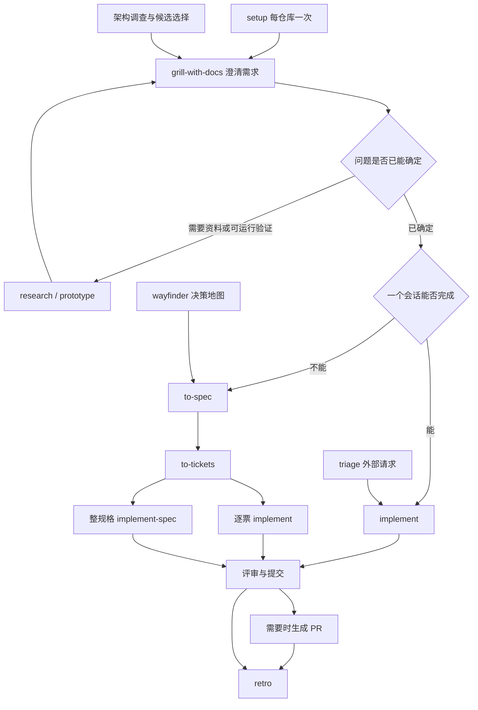

# Matt Pocock Skills 中文使用手册

本手册基于当前仓库源码梳理，核对日期为 2026-10-12，基线提交为 `ac3d709`，插件清单版本为 `1.3.1`。上一版基线为 `68e987c`。适用对象是这套仓库中的 skills，不包括运行环境另外安装的 Superpowers、CodeGraph 等技能。安装命令和更新机制引用仓库自己的约定，不表示本次已安装或验证各客户端兼容性。

## 本次上游更新摘要

- 技能由 37 个增至 38 个：正式 27 个不变，实验性由 6 个增至 7 个，低频 4 个不变。用户触发由 22 个增至 23 个，模型可触发仍为 15 个。
- 新增实验性 `chief-of-staff`：在一个长期会话里协调后台子代理，兼顾当前目标与下一次任务的环境改善。它需要用户显式调用，不随正式插件发布。
- 安装策略改为优先托管插件。仓库新增 Codex、Copilot、VS Code 的托管安装说明，Gemini 和 skills.sh 明确标为手动更新。
- `implement` 收到 ticket 引用后先取回正文并声明标题；使用 TDD 和评审的步骤改为明确调用 Skill tool。
- `tdd` 提议测试 seam 时，要分别说明能捕获什么、会遗漏什么。
- `code-review` 搜索全部规范文件，并同时发起前台 Standards 和 Spec 子代理，再汇总报告。
- `to-tickets` 把父子关系和阻塞关系分开；使用 tracker 原生阻塞关系时，正文不重复维护 Blocked by。
- `wayfinder` 的地图和决策票只用 `wayfinder:*` 标签；研究分支推送保存但不开 PR、不合入主线。
- setup 在 GitHub/GitLab 上补建缺少的标签；grilling 允许用“yes”接受推荐答案；handoff、teach、wizard 补强路径、交互或脚本处理细节。
- 新增 `SCOPE.md` 和若干范围说明；`misc/` 已明确冻结、不维护。完整变化解读见第 8 节后的补充说明。

## 1. 这套框架解决什么问题

它把 AI 驱动开发拆成可以组合的工程方法：澄清需求、建立领域语言、形成规格、拆分任务、编写测试与实现、评审、提交和复盘。

它没有一个自动包办全部阶段的总控制器。人负责选择流程、确定业务决策和认可关键边界；模型负责查事实、执行方法、产出代码与证据。`ask-matt` 是帮助人选择下一步的路由器，不是自动运行全部技能的调度器。

框架强调四件事：

1. 先把需求说清楚，再写代码。
2. 用词汇表和 ADR 保留团队共同理解。
3. 通过可执行反馈证明代码行为正确。
4. 用简单接口封装复杂行为，让代码容易理解、测试和修改。

## 2. 哪些给人调用，哪些给模型调用

这里区分的是**谁可以触发**，不是谁执行。所有 skill 都由模型读取和执行。

| 类别 | 人能显式调用 | 模型能自主调用 | 其他 skill 能调用 | 主要作用 |
| --- | --- | --- | --- | --- |
| User-invoked，用户触发 | 能 | 不能 | 不能 | 人选择流程入口、阶段和决策时机 |
| Model-invoked，模型可触发 | 能 | 能 | 能 | 可复用的工程方法、参考规则、专项能力 |

因此，模型可触发的 skill 也可以由你直接指定；用户触发的 skill 则必须由你明确选择。`wizard` 虽然服务于人的操作，仍属于模型可触发，因为模型可以自行发现需要人工完成的步骤并生成向导。

源码识别方式：

```yaml
# SKILL.md：用户触发
disable-model-invocation: true
```

```yaml
# agents/openai.yaml：配套的显式触发策略
policy:
  allow_implicit_invocation: false
```

模型可触发的 skill 省略上述限制。本次核对 38 个 skill 的这两处声明，没有发现分类冲突。

文中的 `/skill-name` 沿用仓库的命令记法。实际使用时应从当前客户端的技能选择器选择已安装的同名技能，或使用该客户端支持的显式调用方式。普通聊天中提到某个名字，不应被当作所有客户端都支持的命令语法。`/clear` 和 `/compact` 属于客户端会话功能，**不是本仓库的 skill**。

## 3. 全部技能职责

### 3.1 正式工程技能：用户触发，11 个

| Skill | 职责与典型输入 | 主要产物、边界 |
| --- | --- | --- |
| [ask-matt](skills/engineering/ask-matt/SKILL.md) | 输入目前处境，帮助选择技能和路径 | 推荐前须读取相应 SKILL.md，不能只依赖路由摘要；不代替人触发其他用户技能 |
| [setup-matt-pocock-skills](skills/engineering/setup-matt-pocock-skills/SKILL.md) | 每个业务仓库首次使用时配置运行约定 | tracker、分诊标签、领域文档位置和入口指针 |
| [grill-with-docs](skills/engineering/grill-with-docs/SKILL.md) | 在有工作目录的情况下，追问需求、设计和边界 | 清晰决策、`GLOSSARY.md`、必要的 ADR；调用 `grilling` 和 `domain-modeling` |
| [to-spec](skills/engineering/to-spec/SKILL.md) | 把已经讨论清楚的对话综合为规格 | 发布 spec，确认测试边界，标记 `ready-for-agent`；不重新做需求访谈 |
| [to-tickets](skills/engineering/to-tickets/SKILL.md) | 把规格、计划或对话拆成可独立验证的任务 | 纵向切片 tickets、验收标准、阻塞关系；拆分获认可后发布 |
| [implement](skills/engineering/implement/SKILL.md) | 实现明确的规格或任务 | 先获取所引用的任务并声明标题，再调用 TDD 和评审，最后提交当前分支；适合小改动或逐票控制 |
| [implement-spec](skills/engineering/implement-spec/SKILL.md) | 按任务图实现整个规格 | 集成分支；就绪任务由子代理在独立 worktree 执行，汇合后统一评审 |
| [triage](skills/engineering/triage/SKILL.md) | 整理外部提交的 bug、需求，及按配置纳入的 PR | 分类、状态、复现证据、agent brief 或补充信息请求；不直接承担实现 |
| [wayfinder](skills/engineering/wayfinder/SKILL.md) | 面对跨多个会话、路线不明的大工程 | 决策地图及相互关联的决策任务；路线清楚后转入 spec 和实现流程 |
| [improve-codebase-architecture](skills/engineering/improve-codebase-architecture/SKILL.md) | 找出模块难理解、难测试和接口泄漏的改进机会 | 临时目录中的 HTML 架构报告；用户选候选后进一步访谈，不自动重构全部仓库 |
| [retro](skills/engineering/retro/SKILL.md) | 回顾本次或指定开发会话 | 按严重程度排列的环境改进建议，涉及导航、自动检查、规范、工具和文档 |

### 3.2 正式工程技能：模型可触发，9 个

| Skill | 何时使用 | 主要产物、边界 |
| --- | --- | --- |
| [prototype](skills/engineering/prototype/SKILL.md) | 逻辑、状态或 UI 问题无法只靠谈话判断 | 可运行原型及验证结论；逻辑为单 HTML，UI 为可切换的差异化方案；原型保留在非主线分支 |
| [research](skills/engineering/research/SKILL.md) | 技术选择或事实需要查一手资料 | 后台代理研究、带引用的 Markdown；帮助决策，不代替需求澄清 |
| [diagnosing-bugs](skills/engineering/diagnosing-bugs/SKILL.md) | 难复现 bug、间歇错误或性能回归 | 失败反馈循环、最小复现、验证假设、修复及回归证据 |
| [tdd](skills/engineering/tdd/SKILL.md) | 在认可的公共边界逐步实现行为 | 提议 seam 时说明覆盖与遗漏；一个失败测试、最小实现、通过，再做下一行为；重构留给评审阶段 |
| [domain-modeling](skills/engineering/domain-modeling/SKILL.md) | 领域术语模糊、多义，或要保存关键决策 | 校准词汇表、用边界场景检验概念、记录 ADR；不只是读取术语 |
| [codebase-design](skills/engineering/codebase-design/SKILL.md) | 设计模块接口、测试边界和封装方式 | 深模块的共同设计原则：小接口承载大量行为、清晰的 seam、适配器和局部性 |
| [code-review](skills/engineering/code-review/SKILL.md) | 检查相对固定基点的分支变更 | 搜索全部规范来源；同时发起前台 Standards 与 Spec 子代理并汇总；须提供比较基点和规格来源 |
| [pr](skills/engineering/pr/SKILL.md) | 编写 PR 正文 | Summary 最小图示、Before/After 证据、Merge Danger；自身主要是正文模板 |
| [wizard](skills/engineering/wizard/SKILL.md) | 存在只能由人完成的配置、授权或基础设施步骤 | 可交互 Bash 向导；模型可自行完成的步骤不应转交给人 |

### 3.3 正式生产力技能：用户触发，5 个

| Skill | 职责 | 产物、适用边界 |
| --- | --- | --- |
| [grill-me](skills/productivity/grill-me/SKILL.md) | 用持续访谈澄清计划或想法 | 共同理解；不主动保存领域文档。有仓库时通常选 `grill-with-docs` |
| [handoff](skills/productivity/handoff/SKILL.md) | 换客户端、目录、协作者或拆出旁支时交接 | 操作系统临时目录中的交接 Markdown；链接已有产物，保留下一步及建议技能，脱敏 |
| [teach](skills/productivity/teach/SKILL.md) | 围绕真实目标开展跨会话教学 | 工作目录中的教学目标、学习记录、课程、练习及参考资料 |
| [to-questionnaire](skills/productivity/to-questionnaire/SKILL.md) | 关键事实或决策掌握在另一人手中 | 给该人的 Markdown 问卷；先问你接收者和所需答案，不强迫你代答主题 |
| [wait-what](skills/productivity/wait-what/SKILL.md) | 刚才模型的解释没听懂 | 补上下文，用简明语言和领域词汇重新解释，可在其他流程中使用 |

### 3.4 正式生产力技能：模型可触发，2 个

| Skill | 职责 | 被怎样复用 |
| --- | --- | --- |
| [grilling](skills/productivity/grilling/SKILL.md) | 访谈基本方法，把问题展开为决策树，逐步消除未决项 | `grill-me`、`grill-with-docs`、`triage`、`wayfinder`、架构改进流程 |
| [writing-for-agents](skills/productivity/writing-for-agents/SKILL.md) | 写模型能稳定执行的文档，设计指针、步骤、完成标准和渐进披露 | skill、AGENTS.md、CLAUDE.md、代理参考文档，以及 `retro` |

### 3.5 实验性技能：全部用户触发，7 个

这些位于 `in-progress/`，不随正式插件发布，可能改变或移除；如需使用，应单独安装并核对源码。

| Skill | 职责与产物 |
| --- | --- |
| [chief-of-staff](skills/in-progress/chief-of-staff/SKILL.md) | 通过长期会话协调后台子代理推进长期目标，同时改善规范、检查和数据访问等环境；运行环境允许时建议周期安排 |
| [loop-me](skills/in-progress/loop-me/SKILL.md) | 识别工作生活中的重复流程，通过访谈形成 `workflows/*.md` 的可实施工作流规格；不自动部署工作流 |
| [claude-handoff](skills/in-progress/claude-handoff/SKILL.md) | 先把交接摘要保存到系统临时目录，再从文件读入启动新的 Claude 后台代理，减少摘要被 shell 展开的风险 |
| [setup-ts-deep-modules](skills/in-progress/setup-ts-deep-modules/SKILL.md) | 用 dependency-cruiser 约束 TypeScript 包只能通过入口访问实现，测试也通过入口开展 |
| [writing-fragments](skills/in-progress/writing-fragments/SKILL.md) | 访谈挖掘写作素材，积累原始片段 |
| [writing-beats](skills/in-progress/writing-beats/SKILL.md) | 把素材组织成逐个推进的文章节拍，边写边选择后续路线 |
| [writing-shape](skills/in-progress/writing-shape/SKILL.md) | 将 Markdown 原料逐段塑造成文章，讨论结构和表达形式 |

### 3.6 低频技能：全部模型可触发，4 个

这些位于 `misc/`，不随正式插件发布。上游现在明确将其冻结、不维护，不接受针对这些技能的 bug、功能请求和 PR；需要修正时修改自己的副本。

| Skill | 职责与产物 |
| --- | --- |
| [git-guardrails-claude-code](skills/misc/git-guardrails-claude-code/SKILL.md) | 配置 Claude Code hooks，阻止特定危险 Git 命令 |
| [migrate-to-shoehorn](skills/misc/migrate-to-shoehorn/SKILL.md) | 把测试中的 `as` 断言迁移到 `@total-typescript/shoehorn` |
| [scaffold-exercises](skills/misc/scaffold-exercises/SKILL.md) | 生成课程章节、题目、答案和讲解的练习目录骨架 |
| [setup-pre-commit](skills/misc/setup-pre-commit/SKILL.md) | 配置 Husky、lint-staged、格式化、类型检查和测试提交钩子 |

### 3.7 清点结论与版本差异

| 桶 | 用户触发 | 模型可触发 | 合计 | 正式插件包含 |
| --- | ---: | ---: | ---: | --- |
| engineering | 11 | 9 | 20 | 是 |
| productivity | 5 | 2 | 7 | 是 |
| in-progress | 7 | 0 | 7 | 否 |
| misc | 0 | 4 | 4 | 否 |
| deprecated | 0 | 0 | 0 | 否 |
| 总计 | 23 | 15 | 38 | 27 个正式技能 |

核对时发现几处说明与实际文件的差异，使用时应优先参考当前 SKILL.md：

- `docs/engineering/resolving-merge-conflicts.md` 是归档页面，没有对应的当前技能；不要把它计入技能清单。
- README 用 red-green-refactor 概括 TDD；当前 `tdd/SKILL.md` 明确规定红→绿逐片实现，重构放到评审阶段。
- README 安装简介已与 setup 对齐为 GitHub、GitLab、本地文件及用户描述的其他 tracker；上一版手册指出的这一处差异已修复。
- 新增 `chief-of-staff` 已有 SKILL.md 和调用策略文件，但当前 `skills/in-progress/README.md` 尚未列出它，`ask-matt` 也没有它的路由项。因此不能只凭 README 或路由摘要作完整技能清点。

## 4. 流程如何组合

下面箭头表示**使用顺序**。其中不同用户触发技能之间，需要人显式选择下一步，箭头不代表自动调用。



实现流程内部的职责组合：

```text
人选择 grill-with-docs
  模型调用 grilling，追问决策
  模型调用 domain-modeling，保存术语与关键理由

人选择 implement
  模型使用 tdd，在已认可的 seam 上逐片实现
    必要时参考 codebase-design，设计公共接口
  模型使用 code-review，检查规范及规格符合度
  完成检查后提交当前分支

人选择 implement-spec
  读取 spec + tickets 的依赖图
  创建集成分支
  就绪任务 → 独立 worktree 中的实现子代理 → tdd
  合并完成任务，重新计算哪些任务已就绪
  所有任务汇合 → 一次集成评审 → 按 tracker 约定收尾

模型编写 PR 正文
  参考 pr，组织图示、前后证据及合并影响
```

`implement` 正文比较简短，只描述使用 TDD、检查、评审和提交；`implement-spec` 才明确规定多代理、独立 worktree、集成分支和合并角色。不要期待两者具备同样的调度能力。

## 5. 安装与初始化

### 5.1 选择一种安装方式

新版仓库优先推荐托管安装。下面是仓库当前公布的命令，不代表本次已实际执行。

**Claude Code：**

```bash
claude plugin install mattpocock-skills@claude-plugins-official
```

仓库说明：默认自动更新。

**Codex：**

```bash
codex plugin marketplace add mattpocock/skills
codex plugin add mattpocock-skills@mattpocock
```

仓库说明：启动时自动更新。这替代了旧版“Codex 仅走 skills.sh、原生插件还在规划中”的安装说明；它不是对你当前客户端版本支持情况的实测结论。

**GitHub Copilot CLI：**

```bash
copilot plugin marketplace add mattpocock/skills
copilot plugin install mattpocock-skills@mattpocock
```

按仓库说明，在已有 `~/.copilot/settings.json` 中合并一次以下配置，不要覆盖其他设置：

```json
{
  "extraKnownMarketplaces": {
    "mattpocock": { "source": { "source": "github", "repo": "mattpocock/skills" }, "autoUpdate": true }
  }
}
```

仓库明确说明这条配置依据文档 schema，尚未实际运行验证。

**VS Code：**运行 `Chat: Install Plugin From Source`，输入 `https://github.com/mattpocock/skills`。仓库说明其默认每日更新。

**Gemini CLI，手动更新：**

```bash
gemini skills install https://github.com/mattpocock/skills.git --path skills/engineering
gemini skills install https://github.com/mattpocock/skills.git --path skills/productivity
```

两条命令分别安装正式桶，更新时重新执行。

**其他 agent，或希望修改技能文件，使用 skills.sh：**

```bash
npx skills@latest add mattpocock/skills -a <agent>  # cursor, opencode, devin, windsurf, amp, pi; omit -a to choose
```

把 `<agent>` 替换为目标名称，或省略 `-a` 交互选择。按安装器提示选择技能，确保选中 `setup-matt-pocock-skills`。更新已安装技能用 `npx skills@latest update`，上游新增技能还要重新运行 `add` 选择。

只安装单个技能时：

```bash
npx skills@latest add mattpocock/skills --skill=to-spec
```

每个 agent 选择一种路线，避免同名 skill 重复。插件路线提供托管技能包；skills.sh 路线允许修改安装文件，更新时要考虑自己的改动。正式插件只包含正式 27 个技能，实验性及 misc 技能需要另外显式选择。

仓库说明，从自有 marketplace 安装的托管路线以 `plugin.json` 的版本变化触发重装；仅拉取上游源码并不等于客户端已收到新版本。Claude Code 使用官方 marketplace，是另一条发布路径。

本地维护这份源码的开发者可参考 `scripts/link-skills.sh`，它把相应技能链接到本机技能目录，不是用户首次安装的必需步骤。该脚本使用 Bash，Windows 应在兼容环境中运行。

### 5.2 在业务仓库执行一次 setup

打开真正要开发的仓库，显式运行：

```text
/setup-matt-pocock-skills
```

它先检查远程仓库、已有指令文件和领域文档，再确定：

- issue tracker：GitHub、GitLab、本地 Markdown，或你提供的其他工作约定。
- 分诊标签：安装 triage 时，默认 `needs-triage`、`needs-info`、`ready-for-agent`、`ready-for-human`、`wontfix`。
- 领域文档：通常用根目录 `GLOSSARY.md` 和 `docs/adr/`；大型多上下文仓库可以用 `GLOSSARY-MAP.md` 指向各自词汇表。

确认配置草稿后，它写入：

```text
业务仓库/
  CLAUDE.md 或 AGENTS.md         入口指针，按既有文件选择
  docs/agents/
    issue-tracker.md            issue 和 spec 的读写约定
    domain.md                   词汇表、ADR 的位置与使用规则
    triage-labels.md            安装 triage 时生成
```

setup 配置领域文档的约定，不等于已经替你完成领域建模。词汇表和 ADR 可以随讨论按需创建。安装 triage 且选择 GitHub/GitLab 时，新版 setup 还会创建 tracker 中缺少的配置标签，不再只把标签写进本地文档。

以后可直接编辑 `docs/agents/*.md`；换 tracker 或重做配置时再运行 setup。tracker 的操作约定也不等于对应 CLI、连接器和账号权限已经配置成功，真正使用前要检查可访问性。

## 6. 日常使用手册

### 6.1 不知道从哪里开始

```text
/ask-matt
我有一个需求，但不知道应先澄清、做原型，还是直接实现。
目前已知道……，尚未确定……，预计涉及……。
```

它给出路线。然后由你选择并显式调用建议的用户技能。

新版要求 ask-matt 在描述一个技能职责或建议跳过阶段前，先读取对应 SKILL.md；路由摘要只是导航。因此不能只根据一句简介决定省略关键步骤。

### 6.2 一个会话可完成的小需求

1. `grill-with-docs`：说清用户目标、规则、例外和不做的范围。
2. 认可公共接口和测试边界。
3. `implement`：传递本次讨论，执行 TDD、验证、评审、提交。
4. `retro`：在会话仍有完整上下文时复盘。

不必为所有小改动创建 spec 和多张 tickets。

### 6.3 需要多个会话的功能

1. `grill-with-docs` 澄清。
2. 如有事实缺口，用 `research`；如有体验或状态模型缺口，用 `prototype`。
3. `to-spec` 把已作出的决定综合成规格。
4. 认可测试 seam。
5. `to-tickets` 拆分可演示的纵向任务，认可粒度与依赖。
6. 选择逐票 `implement`，或整个规格 `implement-spec`。
7. 检查集成结果、需要时创建 PR，最后 `retro`。

规格应包含问题、解决方案、用户故事、实施决策、测试决策、不做的范围和补充说明。不要把易过时的文件路径和大段代码作为规格主干；原型中更精确表达决策的状态机、schema 等片段可以例外保留。

### 6.4 如何拆票

好的 ticket 完成一条完整行为路径，比如“有权限的主管可以批准申请，申请人看到批准结果”。它可能穿过数据、后端、UI 和测试，但范围足够窄，可以在一个新会话完成。

不建议按“先建所有表、再写所有接口、最后所有页面”的水平层次切票，因为中间阶段难以展示用户价值。

每张票至少写：

- What to build：用户能做什么。
- Acceptance criteria：如何独立验收。
- Blocked by：真实阻塞它的任务。
- Status：当前状态。

大范围机械重构是例外：采用先增加兼容形式、分批迁移、最后移除旧形式的 expand-contract 流程。

新版进一步区分两类关系：父子关系表示“属于哪个规格”，阻塞关系表示“谁没完成就不能开始”。如果来源是 tracker 上的已有 issue，应把生成任务设成它的 sub-issues；阻塞关系优先使用平台原生依赖。已经设置原生依赖时，不在正文再重复维护 Blocked by。不要用父子关系替代阻塞关系。

### 6.5 两种实施方式如何选择

| 情况 | 选择 | 你要提供 |
| --- | --- | --- |
| 小需求、单票，或想逐个控制 | implement | 明确需求或 ticket、测试边界、目标分支 |
| 已有完整 spec 和依赖图，希望自动调度整项工作 | implement-spec | spec、关联 tickets、tracker 约定、集成目标 |

`implement` 会提交当前分支，开始前要选好分支。`implement-spec` 会创建集成分支并处理子代理分支；tracker 以 PR 关闭工作或你要求 PR 时，它在首次合并后创建草稿 PR，最后按流程转为待评审。

新版 implement 收到票号、URL 或本地 ticket 引用后，应先从配置 tracker 获取任务并说出标题，再开始工作。引用有歧义时先澄清，防止实现了同号 PR、别的仓库 issue 或错误的本地任务。

框架描述的多代理流程依赖运行环境提供代理和 worktree 能力。如果不可用，应明确记录偏差，并让人选择逐票执行，不能声称已经完成并行实施。

### 6.6 测试应该怎样使用

seam 是通过公共接口观察行为的位置，比如预约 API、订单模块的公开入口、完整用户交互入口。

先认可 seam，再写测试；只通过公共接口验证实际行为。新版要求每个候选 seam 用一句话说明“能捕获什么、会遗漏什么”，方便你判断测试是否真正覆盖关键路径。每轮先运行测试看到预期失败，再写让它通过的最小代码。预期结果来自已确定的业务规则，不要复制实现算法来计算断言。

按当前 TDD 正文，逐轮进行红→绿；重构在后续评审阶段处理。实现过程中经常跑相关单测和类型检查，收尾跑完整测试集。

### 6.7 Bug 和外部请求

**外部需求队列：**

```text
/triage
查看待评估的问题，优先整理能交给 agent 的事项。
```

分诊会核对已有实现、曾拒绝的范围、实际复现和信息完整度。每个事项应有一个类别和一个状态。`to-tickets` 生成的任务已经是 agent-ready，不需要再次 triage。按 triage 技能发布的 tracker 评论带 AI 生成声明。

**已经明确需要诊断的困难 bug：**

```text
/diagnosing-bugs
用户症状是……；最短操作步骤是……；开始出现的时间或提交是……。
```

实际循环：构建能捕获该症状的失败命令 → 最小化复现 → 列出可证伪假设 → 每次改变一个变量 → 修复和回归验证 → 清理调试产物。

没有可靠反馈命令时先补齐复现条件。若没有能真实覆盖 bug 模式的测试 seam，应把架构问题记录下来，而不是写无法捕获原始 bug 的测试。

若通过人为修改代码或 fixture 强制制造失败，新版要求先与干净副本做 diff，证明该变更确实生效，再相信失败结果。修复后，人应在同一会话显式运行 retro，讨论什么环境改善可以预防再犯；没有合适测试 seam 时再考虑架构调查。

### 6.8 大工程和架构维护

路线尚不清楚、涉及多个会话的工程使用 `wayfinder`：先把不确定性拆成研究、原型、访谈等决策任务，保存地图和决策链接。路线清晰后再手动选择 `to-spec`、`to-tickets` 和实施。

新版 wayfinder 的 tracker 地图与决策票只使用 `wayfinder:map`、`wayfinder:research` 等标签，不叠加 `ready-for-agent` 等分诊状态。决策票与实施票是两类工作。先创建票取得真实 ID，再在第二遍写交叉引用和依赖；不使用 `#<n>` 这种可能错误链接到其他 issue 的占位符。研究结果保存在 `research/<name>` 分支并推送保存，但不创建 PR，也不合并。执行本地 tracker 时则核对本地模板的 Type/Status 约定，不照搬远端标签操作。

想改善现有代码时用 `improve-codebase-architecture`，最好指定常改的模块或具体痛点。先看可视化候选报告，选一个，再讨论模块接口和范围。`codebase-design` 提供设计方法；架构调查负责发现候选，两者职责不同。

### 6.9 评审和 PR

```text
/code-review
基点：main
规格：.scratch/example/spec.md
```

当前 skill 用三点比较 `git diff <fixed-point>...HEAD`，针对相对共同祖先的分支变更。它不天然覆盖未提交工作区，若需要评审未提交内容，必须说明实际检查范围，不能仅凭这条命令声称已经检查。

Standards 轴检查仓库规范及代码异味；Spec 轴检查功能是否兑现规格。新版要求主动搜寻所有规范文件，存在 `CODING_STANDARDS.md` 或 `CONTRIBUTING.md` 时必须纳入。两轴作为前台子代理同时启动并等待汇总，不能仅启动后台任务就宣告评审完成。没有 spec 时该轴应明确跳过，不能把“无规格”当作通过。

实施过程中当前 skill 存在“提交前评审”与“比较 HEAD 的 diff”之间的范围问题。使用时应核对评审是否包括实际待提交变更，必要时要求 agent 明确补充工作区 diff；这是执行适配，不是原 skill 已规定的行为。

需要 PR 时，给模型明确的 PR 创建任务，它可以使用 `pr` 组织正文。`pr` 本身是正文规范，不能把生成正文视作已创建、发布或合并 PR。

### 6.10 会话切换与复盘

优先把需求访谈、规格和拆票保持在同一连续会话中，让下一阶段保留决定背后的理由。任务已经自包含后，可在新会话逐票实施。

| 情况 | 合适动作 |
| --- | --- |
| 下一阶段需要当前讨论原文，且空间足够 | 留在当前会话 |
| 接下来任务与当前上下文无关 | 使用客户端的新会话或清空功能 |
| 换客户端、目录、协作者，或分出旁支 | handoff，携带产物指针 |
| 范围明确的后台任务 | 运行环境支持时委派代理 |
| 上下文仍相关，但需要腾出空间 | 在阶段边界使用客户端压缩功能 |

不要把仓库引用的“约 150k tokens”当作所有模型统一的可靠阈值。按当前客户端和实际上下文状态判断。

`retro` 应在清空前运行；若已换会话，传入原会话日志。它首先提出环境改进候选，不等于自动修改所有指令和工具。

新版范围说明强调：retro 每次都加载 writing-for-agents，即使只读文档和报告，因为它也用该技能中的标准判断指令是否有效。

### 6.11 长期目标如何使用 chief-of-staff

它是实验性用户入口，适合“持续推进某个目标并改善后续任务条件”，而不是普通单票实现。示例：

```text
/chief-of-staff
长期目标：提高会议室预约系统的可靠性。
先梳理错误日志、CI 和可观测性缺口，再协调独立任务逐步改善。
业务范围：预约与取消，不扩展到审批或计费。
```

它要求工作交给后台子代理，主会话保留交流、知识和协调；优先改善检查、规范、日志、测试数据访问等环境，避免靠绕过流程的临时补丁推进。运行环境允许时可以建议周期安排，但建议不等于已经创建定时任务。

与其他入口的区别：wayfinder 解决“大工程的路线怎么确定”；implement-spec 执行“已经明确的 spec 和任务图”；chief-of-staff 承担“长期目标的持续协调与环境改善”。它们不是互相替代。新技能正文尚未定义明确的长期完成标准或持久化知识文件格式，使用时应先明确目标、范围和成果验收，不能假设它已具备完整长期运行平台。

## 7. 贯穿案例：会议室预约

以下是**教学示例，未在本仓库实现**。假设已有一个 TypeScript Web 应用，登录、会议室列表、测试工具均可用。我们增加“预约、冲突检查、取消预约”，使用本地 Markdown tracker，展示一条完整主流程。

### 第一步：初始化项目约定

```text
/setup-matt-pocock-skills
这个项目用本地 Markdown 管理工作，单一领域上下文，保留默认分诊标签。
```

确认草稿后，生成 `docs/agents/issue-tracker.md`、`domain.md`，安装 triage 时还有 `triage-labels.md`，并更新已有指令文件中的入口指针。

### 第二步：澄清需求

```text
/grill-with-docs
给现有应用增加会议室预约。员工可以预约和取消自己的预约。
同一会议室不能有重叠预约，希望先把业务边界说清楚。
```

模型用 grilling 提出问题，人决定规则。例如最终认可：

- 使用已有登录身份，不能代他人预约。
- 开始时间严格早于结束时间。
- 时间区间为半开区间 `[start, end)`，10:00 结束与 10:00 开始不冲突。
- 同一会议室的有效预约不得重叠。
- 并发提交重叠预约时最多一个成功，不能只依赖前端检查。
- 只有预约人可以取消；已取消的预约不占用会议室。
- 本次不做周期预约、审批和通知。

domain-modeling 把“预约”“有效预约”“冲突”加入 `GLOSSARY.md`。并发一致性和区间定义如需要长期保留理由，则写 ADR；不是把每个普通需求都写成 ADR。

**完成标志：**模型能用这些规则逐一解释相邻、重叠、取消和并发场景，人认可解释。

### 第三步：按需要验证一个不确定点

如果人对时间边界仍不确定，可以显式选择模型可触发的 prototype：

```text
/prototype
做一个单 HTML 逻辑演示，验证相邻、重叠、包含和取消后的预约情况。
每次操作显示全部状态。这是规则验证，不是生产实现。
```

验证结论回到规格，原型作为非主线分支上的原始证据被引用。若改到另一目录或会话，使用 handoff 交接结论和链接。规则已清楚时直接跳过原型。

### 第四步：生成规格，认可测试边界

```text
/to-spec
把刚才已经确认的规则整理为会议室预约规格。
```

模型综合讨论，而不是重新访谈需求。它提出例如“通过预约公共 API 验证创建、冲突、取消及权限；保留一条关键浏览器交互测试”。人确认这些测试 seam，后续使用 TDD 时说明各 seam 的取舍：

| 候选 seam | 能捕获 | 可能遗漏 |
| --- | --- | --- |
| 真实预约公共 API | 权限、时间区间、取消语义及真实数据库并发约束 | 页面事件和错误提示呈现 |
| 关键浏览器预约路径 | 页面交互、请求连接和冲突反馈 | 不足以覆盖全部并发排列和领域边界 |

本地 tracker 产物：`.scratch/room-booking/spec.md`。其中包括问题、方案、用户故事、事务或一致性决策、测试决定和明确不做的范围。

**完成标志：**每条已确定规则都能映射到用户故事和验收行为。

### 第五步：拆成完整纵向任务

```text
/to-tickets .scratch/room-booking/spec.md
每张票都要有能独立验证的用户行为，并标明阻塞关系。
```

一个可讨论的拆分：

| 票 | 交付行为 | 阻塞 |
| --- | --- | --- |
| 01 | 员工从页面发起预约，合法预约被保存并显示 | 无 |
| 02 | 重叠预约被拒绝，错误可见，并发也保持最多一个成功 | 01 |
| 03 | 员工查看并取消自己的预约，取消后时段可再次预约，禁止取消他人的预约 | 01 |

这里假设 01 已建立稳定的公共入口和状态契约，使 02、03 可以分别开展；若实测发现它们共享未确定的约束，就补依赖或调整粒度，不为了并行而删除真实阻塞。

这也是假设票按顺序集成、功能尚未开放给真实用户。若系统会持续向用户开放，冲突保护应合入首票，避免中间版本违反核心规则。

人认可拆分后，每票写入单独文件：

```text
.scratch/room-booking/
  spec.md
  issues/
    01-create-booking.md
    02-reject-conflicts.md
    03-cancel-booking.md
```

第二票的简化示例：

```markdown
# 02: 拒绝冲突预约

**What to build:** 重叠预约被拒绝，员工看到原因；并发请求不产生重叠的有效预约。
**Blocked by:** 01: 创建预约
**Status:** ready-for-agent

- [ ] 09:00 至 10:00 的预约阻止 09:30 至 10:30 的预约。
- [ ] 10:00 至 11:00 的相邻预约可以成功。
- [ ] 两个并发的重叠请求最多一个成功。
- [ ] 页面呈现明确的冲突反馈。
```

### 第六步：选择实施方式

**方案 A，由人逐票控制：**

```text
/implement .scratch/room-booking/issues/01-create-booking.md
使用 spec 中已认可的测试边界。
```

完成并核对提交后，开新会话实施 02、03。每张票携带 spec 和 glossary 指针，避免依赖上一会话的隐含理解。

新版 agent 应先读取任务文件并声明“本次实施 01：创建预约”，让你能在动手前发现取错任务；随后明确调用 tdd 和 code-review。

**方案 B，整项工作自动调度：**

```text
/implement-spec .scratch/room-booking/spec.md
关联任务在 .scratch/room-booking/issues/。
按阻塞关系实施所有任务，最后统一评审。
```

模型创建集成分支；先完成 01，再根据真实依赖运行 02 和 03；每个实现代理在独立 worktree 使用 tdd，合并后统一审查集成结果。

两个方案择一。方案 B 运行时不要另开一个不协调的实施流程重复修改相同任务。

### 第七步：看懂一次 TDD 循环

以第二票为例，先通过已认可的公共 API 编写测试：

```text
准备：已有 09:00 至 10:00 的预约
操作：请求同房间 09:30 至 10:30 的预约
预期：请求返回冲突，原预约保持有效，新预约没有成功创建
```

运行看到该测试因实际允许重叠而失败。再写最小的冲突保护，运行看到通过。然后分别推进“相邻允许”“不同房间互不影响”“并发最多一个成功”等行为。

并发测试必须调用真实并发入口和真实约束，不能通过 mock 预设一个请求失败来证明一致性。最终应提供实际命令与输出；本示例没有执行这些测试，因此没有“已通过”的结果。

### 第八步：评审、提交和 PR

模型确认评审覆盖实际变更，沿两个轴检查：

- Standards：是否符合仓库规范，命名是否使用领域词汇，复杂性是否封装在合适接口后。
- Spec：相邻是否允许、重叠是否拒绝、并发是否安全、取消权限是否正确，以及不做的范围有没有被擅自扩大。

需要额外独立评审时：

```text
/code-review
基点：main
规格：.scratch/room-booking/spec.md
```

需要 PR 时给出明确任务：

```text
为预约功能创建 PR，关联本地 spec 和任务，正文使用 pr 技能。
列出实际验证证据和数据库约束变更的回滚影响。
```

PR 正文的证据应来自真正执行的结果：修复前允许重叠，修复后相关测试拒绝重叠；若有 UI 变化，附前后截图。不要把案例里的预期文字当成测试证据。

### 第九步：复盘环境

```text
/retro
复盘刚才预约功能的开发，重点看是否有可自动捕获的遗漏，
以及未来 agent 查找预约规则和并发约束是否方便。
```

可能得到的建议：把并发测试纳入已有 CI，补充领域文档入口，删除过时的指令副本。机械规则优先交给自动检查；需要判断的事项留给编码规范和评审。

案例最终应留下：共同词汇、关键 ADR、spec、独立 tickets、实现提交、真实验证证据，以及有需要时的 PR。复盘则改善下一次开发的环境。

## 8. 常见误区与验收清单

| 误区 | 正确做法 |
| --- | --- |
| 模型可调用就表示人不能调用 | 人可以显式使用所有模型可触发技能 |
| 用户触发 skill 可以自动接着运行另一个用户触发 skill | 模型说明下一步，由人显式选择 |
| 每次都必须经过全部流程 | 按任务规模选最短完整路径 |
| to-spec 会替我想清楚所有需求 | 先澄清，to-spec 综合已经讨论的结论 |
| wayfinder 就是超大实现器 | 它首先解决决策不确定性，再交给规格与实施流程 |
| prototype 就是生产版本的第一稿 | 它用来回答问题，主线只接收被验证的决策 |
| ticket 只要有待办清单就够了 | 要有完整行为、验收标准和依赖 |
| 测试通过就表示规格已兑现 | 还要做 Spec 轴评审，确认没有漏需求或测错行为 |
| retro 是再重构一遍代码 | 它提出改善 agent 工作环境的候选 |
| 写出 PR 正文就等于发布或合并 | 把正文、创建 PR、合并和部署视作不同操作 |

使用前：技能已安装且不重名，tracker 可访问，配置存在，任务范围和目标分支明确。

实施前：关键业务决策已确认，术语一致，测试 seam 已认可，依赖明确。

完成时：验收行为有真实执行证据，评审覆盖全部实际变更，测试及类型检查结果可核对，tracker 按约定更新，没有把生成文档当成已实施功能。

### 新增上游维护边界

这些是上游接受反馈和设计通用技能的范围，不是强制你的业务项目采用相同维护政策：

- 报告现有技能问题时，提供真实会话中“运行了什么、实际做了什么、预期是什么”；纯假设改进不能满足 SCOPE 的门槛。
- misc 已冻结；新 skill 的外部提案和贡献不接收。个人流程可以组合已有技能或在自己的副本里实现。
- grilling 默认使用普通聊天提问，推荐答案的问法应让“yes”表示接受推荐；需要客户端专用问答工具时可在自己的指令文件里表达偏好。
- 同名命令冲突由客户端或个人副本处理；Claude Code 插件可以用 `/mattpocock-skills:research` 等命名空间形式明确选择。
- 子代理无限递归和深度限制被视为运行环境的职责，技能本身不保证防递归。
- teach 的课程路径以启动教学的目录为基准，格式模板以技能目录为基准；测验正确选项的位置应变化。
- wizard 模板改善了带引号值的读取、输入结束处理、新 .env 文件的权限，以及重跑和运行期间编辑的稳健性。作者继续只修改阶段部分，沿用模板函数，不需要为了使用更新而重写向导库。

## 9. 源码依据

- [README：整体理念、正式技能与安装约定](README.md)
- [CLAUDE.md：目录、发布、文档与调用约束](CLAUDE.md)
- [.agents/invocation.md：用户与模型调用的正式定义](.agents/invocation.md)
- [ask-matt：主流程、旁路及选路依据](skills/engineering/ask-matt/SKILL.md)
- [PHASE-BOUNDARIES.md：会话阶段切换](skills/engineering/ask-matt/PHASE-BOUNDARIES.md)
- [安装命令的仓库统一约定](.agents/install-block.md)
- [本地 issue tracker 模板](skills/engineering/setup-matt-pocock-skills/issue-tracker-local.md)
- [.claude-plugin/plugin.json：正式发布的 27 个技能](.claude-plugin/plugin.json)
- [SCOPE.md：上游维护和反馈范围](SCOPE.md)
- [misc 冻结说明](.out-of-scope/frozen-misc-skills.md)
- [子代理递归职责说明](.out-of-scope/subagent-recursion.md)

各技能表已链接相应 SKILL.md。若安装版本与本手册不同，应核对已安装源码，而不是沿用旧描述。
